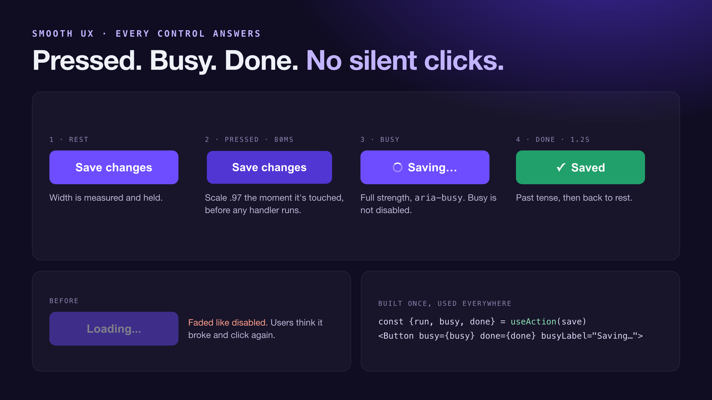
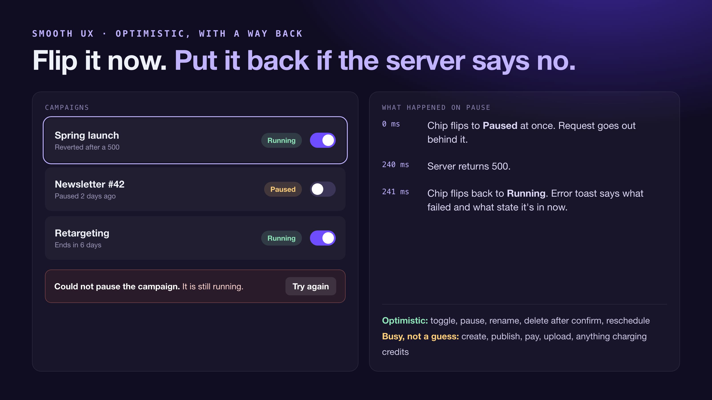
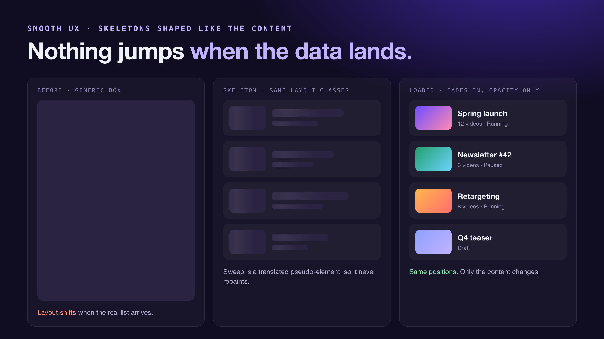

# Smooth UX

A skill for Claude Code and Codex that removes silent clicks from a web front
end. It audits the app, asks you the decisions that are yours, builds a small
set of shared primitives, applies them screen by screen and verifies the
result in a browser.

What your users get:

- **Every click answers.** Buttons press on touch, show a spinner and an
  "-ing" label while working (at full strength, width held), and confirm
  when done.
- **Optimistic UI** for predictable actions (toggles, pause and resume,
  delete after confirm, cancel or reschedule), with a revert and a reason
  when the server says no. Server-decided actions (create, publish, pay,
  upload) get a busy state, not a guess.
- **Content-shaped skeletons** per screen and per route, so nothing jumps
  when data lands.
- **Instant route feedback:** the clicked link shows it is working, the
  route skeleton appears, the page fades in.
- **Cheap motion:** transform and opacity only, short durations, reduced
  motion respected, and no fade on the first page load.

The templates target React and Next.js (app router); the process and the
rules apply to any front end.







## Install

### Claude Code

```bash
claude plugin marketplace add thinhledev/smooth-ux
claude plugin install smooth-ux@smooth-ux
```

Then ask: "the app feels static, nothing happens when I click", or run
`/smooth-ux:smooth-ux`.

### Codex

```bash
codex plugin marketplace add thinhledev/smooth-ux
```

Then install **Smooth UX** from the Plugins Directory.

### Agensi

[Get Smooth UX on Agensi](https://www.agensi.io/r/THINHLE?to=/skills/smooth-ux-make-your-web-app-feel-responsive), the marketplace for agent skills. It's free with an Agensi account.

<sub>This is my referral link. If you create an Agensi account through it, I earn a commission on skills you buy there in your first 6 months. It costs you nothing extra.</sub>

### Any agent that reads Agent Skills

Copy `skills/smooth-ux/` into the agent's skills folder (for example
`~/.claude/skills/` or `~/.codex/skills/`).

## Contents

| Path | What |
|---|---|
| `skills/smooth-ux/SKILL.md` | The process, the optimistic-or-not decision table, verification steps |
| `skills/smooth-ux/references/primitives.md` | CSS tokens, Button, useAction, toasts, link pending, page fade, skeletons, optimistic patterns |

## License

MIT
